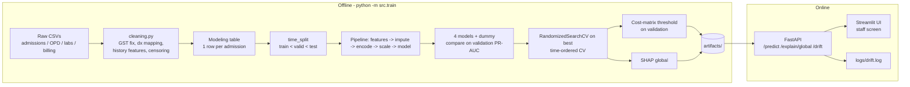

# Architecture

## 1. Purpose
Early-warning system for a (fictional) Pune network of community clinics: given a patient at discharge, estimate the probability of **unplanned readmission within 30 days**, explain *why*, and let staff act on it from a simple web screen.

## 2. System overview

## 3. Components
| Component | File(s) | Responsibility |
|---|---|---|
| Data generator | `src/data_generation.py` | Creates the 4 raw tables (~495k rows) with the problems from the brief |
| Cleaning / merge | `src/cleaning.py` | GST double-count fix, free-text diagnosis -> 9 groups, leakage-safe history counts, right-censoring, chronological split |
| Pipeline | `src/features.py` | One sklearn `Pipeline`: `FeatureEngineer` -> `ColumnTransformer` (median impute + scale; mode impute + one-hot) -> model |
| Training | `src/train.py` | Trains logistic regression, random forest, XGBoost, LightGBM; tunes best; picks threshold; SHAP; writes artifacts + model card |
| Explainability | `src/explain.py` | SHAP (`TreeExplainer` / `LinearExplainer`), global + per-patient |
| Drift | `src/drift.py` | PSI + KS test of new data vs training sample; WARNING to `logs/drift.log` |
| API | `api/main.py` | Validated REST service, loads artifacts once at start-up |
| UI | `app/streamlit_app.py` | Form -> `/predict`, shows score, flag, top factors, global SHAP |
| Tests | `tests/` | 22 tests: cleaning, pipeline, time split, API, latency, drift |

## 4. Key design decisions
| Decision | Why |
|---|---|
| **Chronological split** (train 2023-01 -> 2024-04, valid -> 2024-08, test -> 2024-11) | A random split lets the model learn from the future; the real system always predicts forward in time. |
| **History features count only strictly earlier events** (`count_events_before`) | Prevents leakage of the target's own period into features. |
| **Drop admissions in the last 45 days** | Their 30-day follow-up window is incomplete, so labels would be wrong (right-censoring). |
| **One pipeline object for training and serving** | Same imputation/encoding in the API as in training - no train/serve skew. Unseen categories are ignored, not crashed on. |
| **Missing LOS/discharge date kept as NaN**, imputed in the pipeline (median + missing indicator) | Imputation is fitted on train only; "missing" itself can be informative. |
| **PR-AUC as the chosen metric** | ~13% positives; ROC-AUC flatters. PR-AUC measures how full the top of the list is with real readmissions. |
| **Class weights / `scale_pos_weight`** | Handles imbalance without altering the data. |
| **Threshold from a cost matrix, not 0.5** | The business cares about rupees: missed readmission INR 40,000 vs wasted call INR 1,500. See `MODEL_CARD.md`. |
| **Threshold chosen on validation, metrics reported on a later test set** | Test set is never used for any choice. |
| **SHAP in the response** | Staff see the top-5 reasons per patient (~15-25 ms total). |
| **Artifacts as plain files** (`joblib`, JSON, CSV) | Simple, versionable, no DB needed for this scope (see `DATABASE.md`). |

## 5. Runtime view
1. API start-up (`lifespan`): load `model.joblib`, `threshold.json`, `metrics.json`, `reference_sample.csv`, build SHAP explainer, warm up one prediction.
2. `POST /predict`: pydantic validation -> DataFrame (None -> NaN) -> `predict_proba` -> compare with threshold -> SHAP top-5 -> response. Request features are also kept in an in-memory buffer (last 2,000) for `/drift`.
3. `GET /drift`: compares that buffer with the training reference sample; drifted features are logged as WARNING.

## 6. Non-functional targets
| Target (from brief) | Measured |
|---|---|
| API < 300 ms | ~15-25 ms per request including SHAP (test asserts median < 300 ms) |
| Beat baseline by >= 20 % on chosen metric | PR-AUC 0.462 vs 0.191 rule baseline (+141 %); only +4 % vs untuned logistic regression - see `TODO.md` caveat |
| Whole project from a fresh clone with one command | `python run_all.py` or `docker compose up --build` |

## 7. Extension points
Real data -> replace `generate()` with a loader producing the same four tables. New model -> add to `candidate_models()` and `SEARCH_SPACES`. New cost assumptions -> edit `src/config.py`, retrain. Auth, DB, scheduling -> see `DEPLOYMENT.md` and `TODO.md`.
